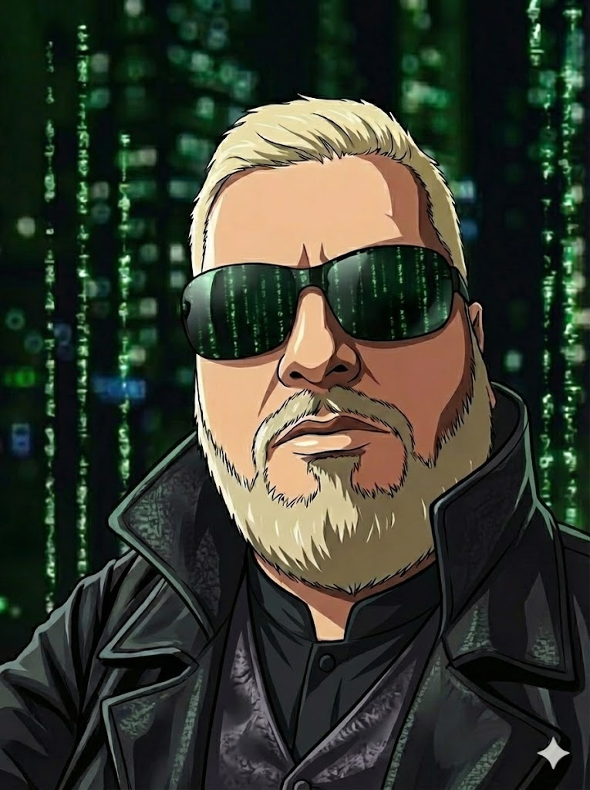

# William Nunes

## Where AI agents meet real work.

I turn manual, repetitive operations into software: autonomous agents, automated workflows and the secure foundations they run on. Shipped to production, not left in slides.

  <a class="hero__link hero__link--primary" href="{{ '/projects/' | relative_url }}">View projects</a>
  <a class="hero__link hero__link--secondary" href="{{ '/about/' | relative_url }}">About me</a>

<ul class="hero__highlights" aria-label="Focus areas">
  <li>AI Agents</li>
  <li>Workflow Automation</li>
  <li>Secure by Design</li>
</ul>
